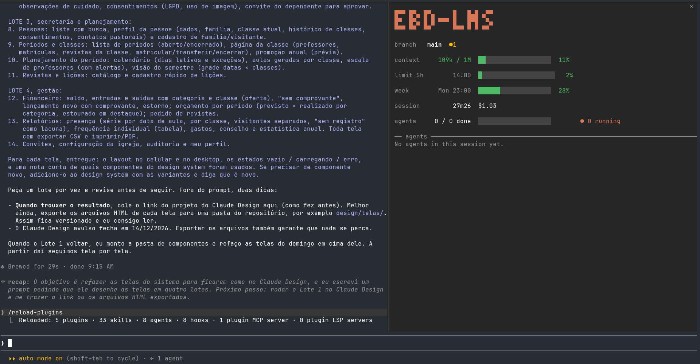

# agents-pane

A live pane for Claude Code that shows every subagent working in your session.

When you run long orchestrations with many subagents in the background, it is hard to know what is going on. `/tasks` gives you a raw list. **agents-pane** gives you a dashboard: who is running, who is done, how long each one took, and how far the orchestration plan has come.



The same layout in text, during an orchestration grouped by ticket:

```
 █▀▄ ▄▀▄ ▄▀▀ ▀█▀ █▀▄ ▄▀▀     █ █ █▀▀ █▀▄
 █▀▄ █▀█ █    █  █ █ █ █ ▀▀▀ ███ █▀  █▀▄
 ▀ ▀ ▀ ▀  ▀▀ ▀▀▀ ▀ ▀  ▀▀     ▀ ▀ ▀▀▀ ▀▀

 branch   pane-stats  ●3 ↑2  worktree

 context     583k / 1M  ████████████░░░░░░░░  58%
 limit 5h        16:40  ███████░░░░░░░░░░░░░  34%
 week        Sun 09:00  ██████████████░░░░░░  71%
 session         2h14m  $3.42

 agents     6 / 7 done  ████████████████████  86%   ● 1 running

 ── agents ─────────────────────────────────────────────────────
 MYK-983  spec S0
   ✓  Implement                   86t   15m26  bg
   ✓  Review                      30t    4m07  bg
   ✓  Re-review fix round 1        4t     34s  bg

 MYK-984  S1 classics+harness
   ✓  Implement                  131t   27m10  bg
   ✓  Review                      29t    3m29  bg

 MYK-986  Maxwell tunnel
   ◐  Implement                   41t    2m08  bg           ▂▄▇█

   ✓  Scan the repo for pane h…   12t    1m01      Explore
```

## Features

- **Repo and context**: the name of the GitHub repo in big letters, three rows tall (the same in every worktree), and under it how full the session's context window is; the bar is green, turns yellow at 70% and red at 85%. The agents bar shows done in green, running in the accent and failed in red.
- **Branch line**: the branch you are on (or the short hash when HEAD is detached), changed files in yellow, commits ahead (`↑`) and behind (`↓`) the upstream, and `worktree` when the session runs in one. Handy because Claude Code only shows the branch when the conversation starts.
- **Usage limits and session**: the 5-hour and weekly limits with their reset time and a bar in the context colors, and how long the session has run, with its cost in dollars when you pay per API call. Rows with nothing to show are left out.
- **Stats table**: context, limits, agents and (when Claude keeps a task list with `TaskCreate` / `TaskUpdate` / `TodoWrite`) tasks, each with its value, a bar of the same width and a percentage, in fixed columns.
- **Agents grouped by ticket**: when a description names a ticket (`MYK-983`, `ABC-12`), the agents of that ticket share a header and each row keeps only what is its own (`Implement`, `Review`). Agents without a ticket close the list; with no ticket at all the list stays flat.
- **Live rows**: status, task, tool calls, elapsed time and `bg` for background agents, in columns that never move; only the description gives way. The type shows only when it is not `general-purpose`. A running agent has a sparkline of its tool calls per minute over the last four minutes.
- **Fits the pane**: from 40 rows a blank line sits between every row of the header; under 40 columns the reset times, the mode and the sparkline go; under 12 rows the pane turns compact (the name in plain text, the branch and the stats on one line, a flat list).
- **ASCII fallback**: `AGENTS_PANE_ASCII=1` draws without block glyphs, for fonts that lack them.
- **Fixed header**: the summary stays visible while you scroll the list.
- **Catches up**: agents that started before the plugin loaded (or before a `/reload-plugins`) are picked up too.
- **English and Portuguese** labels.
- **Works on every Claude Code surface**: terminal, desktop app and VS Code.

## Install

In a Claude Code session:

```
/plugin install agents-pane --marketplace bruno88cabral/agents-pane
```

Answer `y` to add the marketplace and choose the **user** scope, so the pane works in all your projects.

On an older Claude Code without `--marketplace`, add the marketplace first:

```
/plugin marketplace add bruno88cabral/agents-pane
/plugin install agents-pane@agents-pane
```

From a shell, the same thing:

```bash
claude plugin install agents-pane --marketplace bruno88cabral/agents-pane
```

In the desktop app: click **+** next to the prompt box, then **Plugins**, **Add marketplace** with `bruno88cabral/agents-pane`, then **Add plugin**.

**Requirements:** a Claude Code version with hooks modules (tested on 2.1.301).

## Usage

Run `/agents-pane` to open the pane.

On a wide terminal (144 columns or more) the pane also opens by itself when a session starts. On a narrower terminal Claude Code only shows panes you ask for, so use the command.

To try it, ask Claude for something that runs agents in parallel, for example: *"explore this repo with 3 subagents in parallel and summarize the architecture"*.

## Configuration

| Option     | Values          | Default |
| ---------- | --------------- | ------- |
| `language` | `en`, `pt-BR`   | `en`    |

Change it in the Claude Code config menu (`/config`), under **agents-pane**.

Set `AGENTS_PANE_ASCII=1` in the environment Claude Code starts in to draw the pane with plain ASCII (`#` and `-` bars, `ok` / `..` / `x` / `.` for the status).

## How it works

The plugin is a Claude Code hooks module. It listens to a few engine events and keeps a small state per session:

| Event                                                  | What the pane does with it                                                    |
| ------------------------------------------------------ | ----------------------------------------------------------------------------- |
| `agent.spawn`                                          | Adds a row with type, description, model and start time                       |
| `tool.call` inside an agent                            | Counts one tool call for that agent                                           |
| `SubagentStop`                                         | Marks the agent as done and stops its clock                                   |
| `tool.call` on `Agent`                                 | Marks the agent as failed when the call errors                                |
| `TaskCreate` / `TaskUpdate` / `TaskList` / `TodoWrite` | Keeps the orchestration task list in sync                                     |
| `$.agent.list()` every second                          | Shows finer live states (waiting, idle) and adopts agents it has not seen yet |
| `$.session.repo()` / `$.session.usage()`               | Fill the header with the repo name, the context fill, the limits and the session |
| `git status` / `git rev-parse` every 5 seconds         | Fill the branch line                                                          |
| `session.measure`                                      | Redraws the pane as soon as the context fill moves                            |

The plugin never changes what Claude does. Every hook passes the event on untouched, and if a hook fails it is skipped.

### Project layout

```
.claude-plugin/
  plugin.json         manifest and the language option
  marketplace.json    makes this repo installable with one line
hooks/
  core.ts             harness-agnostic model, reducers, text helpers and labels
  layout.ts           the pane as lines of colored segments, pure
  register.tsx        Claude Code adapter: events in, painted lines out
  *.test.ts(x)        tests for both
types/
  index.d.ts          data model and state contract
```

`core.ts` and `layout.ts` do not know about Claude Code. `layout({ width, height, context, agents, ... })` returns the pane as lines, each a list of segments with a color role (accent, ok, warn, error, dim), and `plain()` turns them into strings, so the whole layout is tested without a terminal. `register.tsx` only turns Claude Code events into calls to the core and paints those lines. This split is on purpose: support for other agent harnesses would be a new adapter on top of the same core.

## Known limits

- **Agents adopted late** (started before the plugin loaded) show elapsed time from the moment the pane saw them, and their tool calls count from zero. The engine does not expose the real start time.
- **The sparkline starts over on a reload**: the per-minute counts live in memory, not in the session state.
- **Organizations with managed settings**: there, `SubagentStop` hooks only run for plugins the organization lists. Agents still show, but may stay as running until the live list reports them as done.
- Hooks modules are an **early access** API in Claude Code, so a future release may break something. Issues are welcome.

## Development

```bash
git clone https://github.com/bruno88cabral/agents-pane
cd agents-pane

claude plugin validate .      # checks manifest, hooks and state contract
claude plugin test .          # runs hooks/*.test.ts(x) against the engine
claude --plugin-dir .         # runs a session with the plugin, reloads on save
```

For type checking, run `claude --plugin-dir .` once so Claude Code writes its types into `.claude-plugin/types/`, then `tsc -p .`.

## Roadmap

- [ ] Open an agent's transcript from its row
- [ ] Token usage per agent
- [ ] Donut chart on the desktop surface
- [ ] Adapters for other agent harnesses (Codex CLI, OpenCode, ...)

## License

[MIT](LICENSE) © Bruno Cabral
